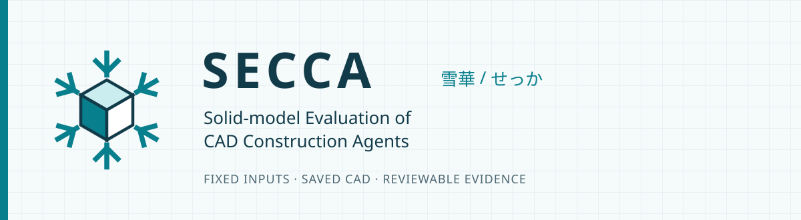
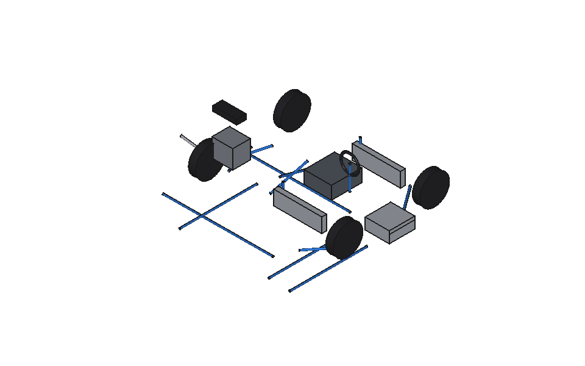
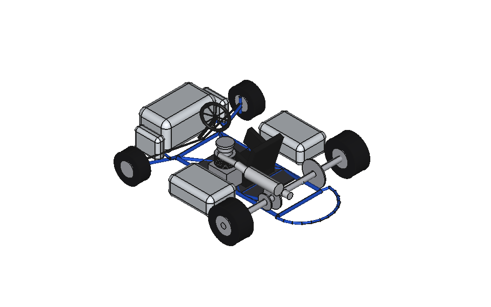
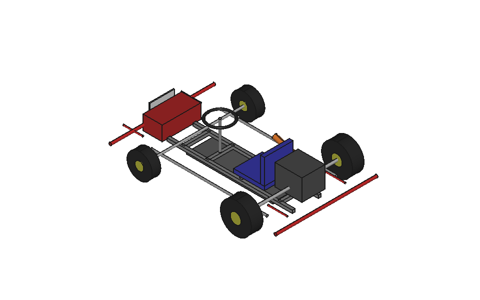

<p align="center"></p>

<p align="center"><a href="README.md">English</a> · <strong>日本語</strong></p>

<p align="center">
  <a href="https://github.com/Sunwood-ai-labs/SECCA/actions/workflows/ci.yml"></a>
  <a href="https://github.com/Sunwood-ai-labs/SECCA/actions/workflows/pages.yml"></a>
  <a href="LICENSE"></a>
  
</p>

SECCAは、固定のレーシングカート画像と依頼文から、CAD構築エージェントがFreeCAD・STEPファイルを作る過程を評価するプロジェクトです。固定プロトコル、隔離実行ツール、白背景の描画画像、採点根拠を保存します。正式名は **Solid-model Evaluation of CAD Construction Agents**。日本語名は **雪華（せっか）** です。

[ドキュメント](https://sunwood-ai-labs.github.io/SECCA/ja/) · [試行の実行](docs/ja/guide/run.md) · [結果と限界](docs/ja/guide/results.md) · [プロトコル](assets/protocol.json)

## ❄️ 固定課題と確認できる根拠

- 候補へ渡すのは、元画像と固定の日本語依頼文です。
- OpenCode、FreeCAD、FreeCAD MCPを新しいPodmanコンテナで動かします。ホストのCAD、他試行、採点資料は渡しません。
- 保存CADを別の通信できないコンテナで開き、固定の斜視・上面・右面を白背景で描画します。
- モデル名を知るコーディネータ1件と、新しいコンテキストでモデル名を伏せた独立評価2件を保存します。項目ごとの中央値を合計します。

現在の課題は見た目の再現を評価する実験です。正確な寸法、機械としての動作、製造適性、モデル全体の性能を示すものではありません。

## 🧪 公開実験

### Nemotron・DeepSeek · 2026-10-18

| Nemotron 3.5 Super VL Free | DeepSeek V4.1 Flash Free |
| --- | --- |
|  |  |
| 見た目の再現度 **28.75/100点** | 見た目の再現度 **50/100点** |
| FCStdは30有効ソリッド。STEPは形状なし。 | FCStd・STEPとも26有効ソリッド。 |
| 生成時間は71.464秒。 | 生成時間は442.688秒。 |

同じ固定入力とランタイムイメージを使い、モデルごとに独立したPodman環境で1生成物ずつ作りました。各生成物をコーディネータ1件と、新しいコンテキストでモデル名を伏せた独立評価2件で採点し、項目別中央値を合計しています。CADの成立は再現度とは別に判定し、Nemotronは空のSTEPにより出力一式の検査に不合格でした。

この2生成物の結果から、モデル全体の順位や速度の優劣は示していません。CAD本試行の推論リクエスト本文は保存しておらず、画像ペイロードを通信記録と照合することはできません。OpenCodeの記録費用は各0ドルですが、請求明細は独立監査していません。過去のBeamとWindows版GLMはランタイムが異なるため、別の記録として扱います。

[実験ファイルと根拠](experiments/dual-free-20261018/README.md) · [結果と採点理由](docs/ja/guide/results.md)

### Beam Free · 2026-10-17



| 実験 | 結果 | 対象 |
| --- | --- | --- |
| Beam Free、2026-10-17 | 1生成物の評価は **25/100点** | 2試行のうち1件を採点。初回は準備段階でHTTP 403。 |

採点した試行の生成時間は152.219秒、OpenCodeの記録費用は0ドルでした。費用はクライアントの記録値で、請求明細を監査した値ではありません。保存したFCStdとSTEPは再オープンでき、各33ソリッド、無効形状0でした。CADの成立は再現度の点数へ加算しません。

Beam Freeのカタログは入力をテキストのみとしています。エージェント自身がPythonで参照画像の画素を調べました。今回は**ネイティブな画像入力機能の実測ではありません**。旧GLMの43点はWindowsホスト版であり、今回の隔離実行との厳密な比較には使えません。

[実験レポート](experiments/beam-free-20261017/REPORT.md) · [採点](experiments/beam-free-20261017/trial-02/score.json) · [CAD検査](experiments/beam-free-20261017/trial-02/evidence/validation.json)

## 🚀 はじめに

Python 3.12以降、[uv](https://docs.astral.sh/uv/)、稼働中の**名前付き接続**を持つPodmanが必要です。ホストへのFreeCAD・OpenCodeのインストールは不要です。コマンドはリポジトリのルートで実行してください。

1. リポジトリを取得し、固定資産を検査します。この段階ではモデルAPIを呼びません。

   ```sh
   git clone https://github.com/Sunwood-ai-labs/SECCA.git
   cd SECCA
   uv run --frozen python scripts/candidate.py verify-assets
   ```

2. Podmanのマシンと接続を確認し、ランタイムをビルドします。`<CONNECTION>` は稼働中の接続名へ置き換えてください。実行ツールはタグの `localhost/kart-sbx-` 接頭辞を必須としています。

   ```sh
   podman machine list
   podman system connection list
   uv run --frozen python scripts/candidate.py build --connection "<CONNECTION>" --tag localhost/kart-sbx-secca:v0.1.0
   ```

3. [試行の実行手順](docs/ja/guide/run.md)に沿って、利用を認められた提供元とモデルを選び、新しい試行を準備・実行・回収します。実行時は提供元APIを呼び、既存のアカウント設定に応じて費用が発生する場合があります。

コンテナの構築手順はバージョンと解決済みイメージIDを記録します。依存先を将来も完全に同じ状態で再取得できる保証はありません。別のマシンでも同じランタイムを使う場合は、OCIイメージを保存してください。

## 📐 採点と比較

| 項目 | 配点 |
| --- | ---: |
| 輪郭・比率 | 25 |
| 部品の配置 | 20 |
| 特徴的な形状 | 30 |
| 機械的な細部 | 20 |
| 配色 | 5 |

評価者は参照画像と標準の3方向画像を確認し、各点数に見える部位の根拠を添えます。時間、費用、書き出しの成功、ソリッド数、未確認の寸法は加点しません。失敗や採点不能は状態を残し、架空の点数で補いません。[採点手順](docs/ja/guide/scoring.md)を参照してください。

依頼文、参照画像、ツールのバージョン、ランタイム、描画条件、配点が変われば比較条件も変わります。差分を記録し、厳密な比較では同じ条件で基準モデルも再実行してください。このリポジトリはモデルの順位表を確立していません。

## 🗂️ リポジトリ構成

| パス | 内容 |
| --- | --- |
| `assets/` | 固定の依頼文・画像・プロトコル・配点・描画条件、旧基準例 |
| `scripts/`、`container/` | 試行実行、API中継、CAD検査、採点、同梱MCP |
| `references/` | 詳細手順と検証原記録 |
| `experiments/` | 公開実験のレポートと成果物 |
| `docs/`、`brand/` | 日英ドキュメントとオリジナルSVGロゴ |

## 🛠️ 開発と検証

```sh
uv run --frozen python -m unittest discover -s scripts -p "test_*.py"
uv run --frozen python scripts/candidate.py verify-assets
npm ci
npm run docs:check
npm run docs:build
npm run docs:dev
```

ビルド先は `docs/.vitepress/dist`、公開パスは `/SECCA/` です。プレビューはVitePressが表示するURLを使います。単体テスト、ランタイムの起動確認、保存CADの再検査は、新しいモデルによる生成とは区別します。[隔離と検証の限界](docs/ja/guide/isolation.md)を参照してください。

## 📄 権利と来歴

[MITライセンス](LICENSE)は、記載された範囲のプロジェクトコードとオリジナルロゴに適用されます。同梱FreeCAD MCPには[独自のMITライセンス](container/vendor/freecad-mcp/LICENSE)があります。参照画像はユーザー提供のスクリーンショットで、元の出典・作者・ライセンスは記録されていません。**コードのライセンスから、画像の利用・再配布許諾を推定しないでください。** 生成CADや描画画像も、描かれたデザインの権利を確定するものではありません。[来歴と権利](docs/ja/guide/provenance.md)、[データ来歴](NOTICE.md)に記載しています。

[貢献方法](CONTRIBUTING.md) · [セキュリティ](SECURITY.md) · [引用情報](CITATION.cff)
