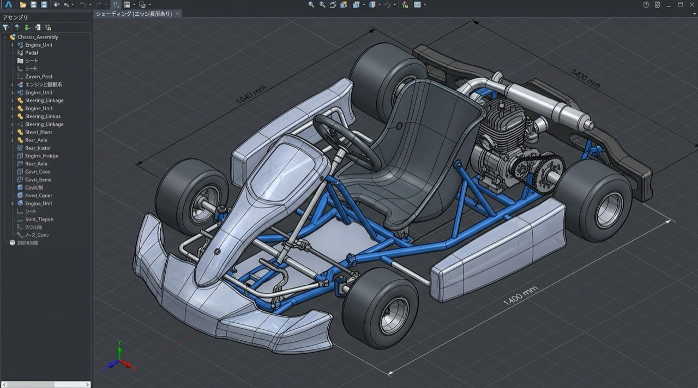
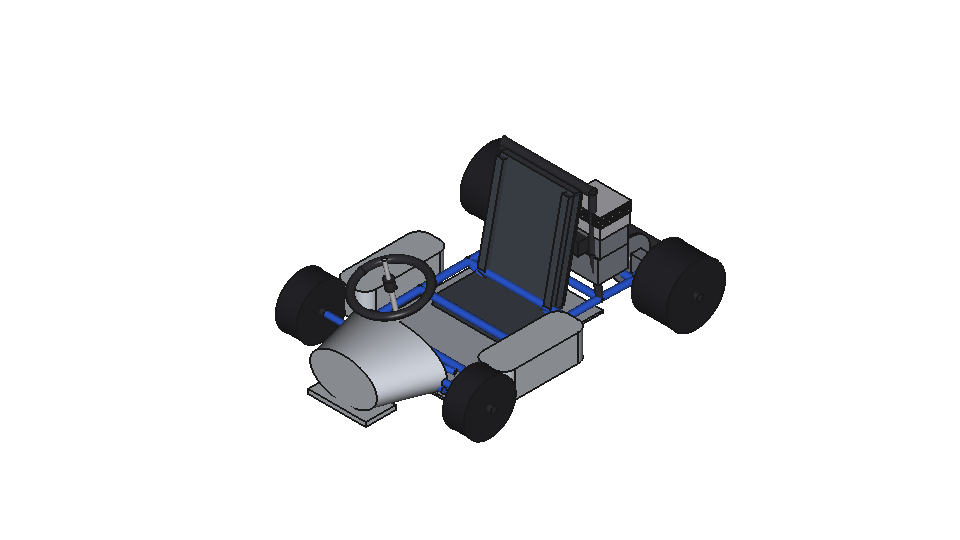
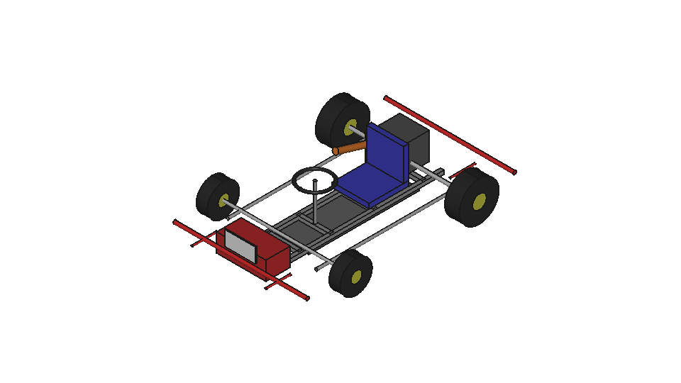
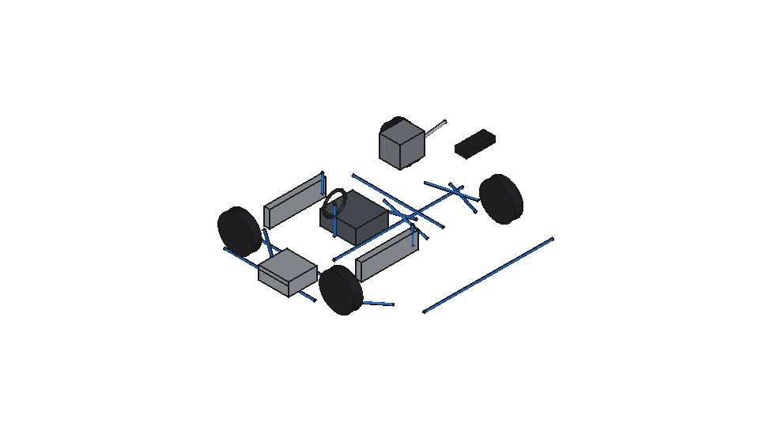
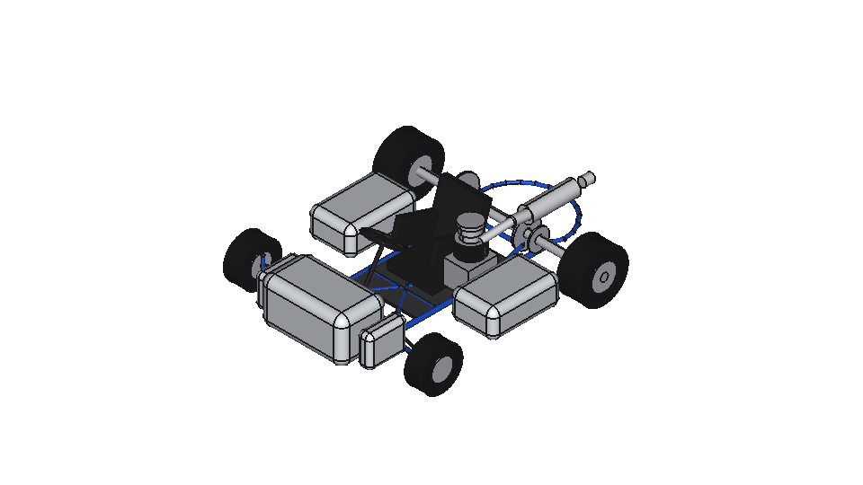

# Four saved karts viewed from the reference direction

The four saved CADs now have a common semantic front-left view, with their noses at lower left and rear ends at upper right. The original input camera cannot be recovered exactly from one JPEG. These are reproducible near-reference supplemental views.

The standard renderer fixes a camera in world coordinates. GLM, Beam, Nemotron and DeepSeek built their fronts along different world axes, so the original fixed camera showed different sides. This presentation pass applies a recorded camera yaw for each saved CAD. It leaves geometry, colors, visibility, original images and scores unchanged.



| GLM 5.3 Flash Free, original score 43/100 | Beam Free, original score 25/100 |
| --- | --- |
|  |  |
| Nemotron 3.5 Super VL Free, original score 28.75/100 | DeepSeek V4.1 Flash Free, original score 50/100 |
|  |  |

These scores were assigned using the original evaluation images. This pass did not generate CAD, repair output, invoke a candidate model, or rescore any sample. The historical GLM sample ran on Windows; the other samples used Podman. Shared presentation conditions do not make those generation environments identical. Nemotron's original STEP still imports zero shapes.

## Camera and source records

- [spec.json](spec.json) defines the shared orthographic projection, 45-degree semantic azimuth, 35.264-degree elevation, white background, 1600 by 900 image and 960 by 540 preview.
- [sources.json](sources.json) binds the four original FCStd paths and hashes, their generation runtimes, helper revision and unchanged historical files.
- [camera-analysis.json](camera-analysis.json) records the front/up-axis evidence and its uncertainty. GLM front is +Y, Beam and DeepSeek front are +X, and Nemotron front is -X. All use +Z up. World-Z camera yaws are 0, -90, -90 and +90 degrees respectively.
- [manifest.json](manifest.json) binds the published scripts, specification, sources, images, public evidence and original private evidence hashes.
- The [GLM](artifacts/glm/evidence.json), [Beam](artifacts/beam/evidence.json), [Nemotron](artifacts/nemotron/evidence.json) and [DeepSeek](artifacts/deepseek/evidence.json) evidence records contain requested and actual camera quaternions, PNG checks, original-CAD hash checks, FreeCAD version and distinct offline rendering container IDs.
- [visual-qa.json](visual-qa.json) records direct inspection of all eight rendered images against the input. The camera direction, white background and framing passed for all four models. Byte preservation is checked separately with hashes.

The original standard images and scoring evidence remain at [GLM](../../assets/baseline/evidence/), [Beam](../beam-free-20261017/trial-02/renders/), [Nemotron](../dual-free-20261018/nemotron/trial-01/renders/) and [DeepSeek](../dual-free-20261018/deepseek/trial-01/renders/).

Two successful presentation attempts are retained in the private research record. The first tested the image exporter and camera. Its host-side execution source snapshot was absent, so it is a prototype. The second accepted attempt binds the final renderer, worker, camera specification, sources, axis analysis and helpers with start/end SHA-256 snapshots. Each FreeCAD worker also verifies the uploaded runtime source hashes. Both attempts use the same camera rules and original CAD bytes. The public manifest lists their IDs and identifies the accepted attempt. This is presentation iteration, with no repeated model generation or judging.

## Reproduce without model inference

From the repository root, verify the package and its historical sources:

```sh
uv run --frozen python experiments/reference-view-20261018/renderer.py selftest
uv run --frozen python experiments/reference-view-20261018/renderer.py verify
```

To render again, use an existing named Podman connection and the immutable runtime image below. Each source opens in a fresh network-none container with UID 10000, read-only root, no host binds and no capabilities. The script removes only its own container ID. It records a new presentation attempt under the chosen output directory.

```sh
uv run --frozen python experiments/reference-view-20261018/renderer.py render \
  --connection YOUR_NAMED_CONNECTION \
  --image-id sha256:b9e296032f921c96de5843b19e1a182ce5067d6cdca25a5d3ab7e7da23fe89cb \
  --output /absolute/path/to/new-output
```

The renderer imports the repository's offline-container and FreeCAD helpers. Their hashes are pinned in `sources.json`; helper changes require an explicit new presentation record. It uses no canonical trial or render-spec override. It closes each CAD without saving or recomputing it.

Publication uses an allowlist export. After direct image QA has produced a compatible `visual-qa.json`, export with the following command. It independently queries the four exact rendering container IDs to confirm cleanup, then verifies the public package. Raw host command logs and machine-specific paths stay in the private output directory.

```sh
uv run --frozen python experiments/reference-view-20261018/renderer.py export \
  --connection YOUR_NAMED_CONNECTION \
  --output /absolute/path/to/new-output \
  --visual-qa /absolute/path/to/visual-qa.json
```

Public evidence names each transformation and keeps both original and published evidence SHA-256 values. PNG bytes are copied unchanged. The original reference image and generated CAD retain the data-rights context documented in the source experiments; this presentation adds no new rights grant.

日本語要約。車体の前方向に合わせてカメラを回し、4モデルとも入力画像に近い方向から描画した。元画像の厳密なカメラ値は不明なので、同一視点の完全再現とはしていない。元のCAD、標準画像、43点・25点・28.75点・50点の採点記録は保持している。4つを別々の通信できないPodmanコンテナで描画し、元ファイルのハッシュ、実カメラ、白背景、切れの有無と清掃を検証した。
